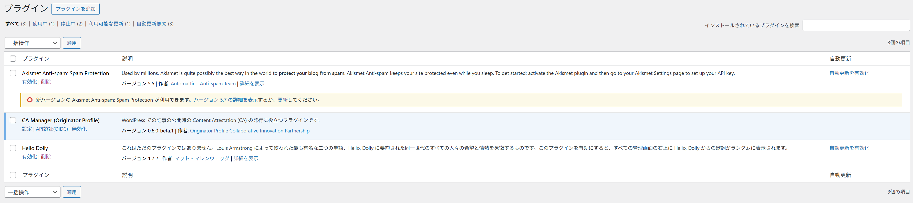
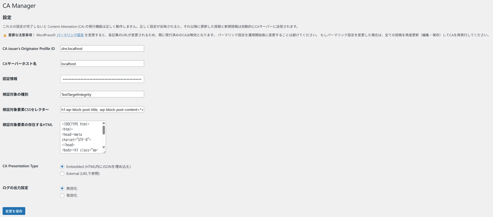
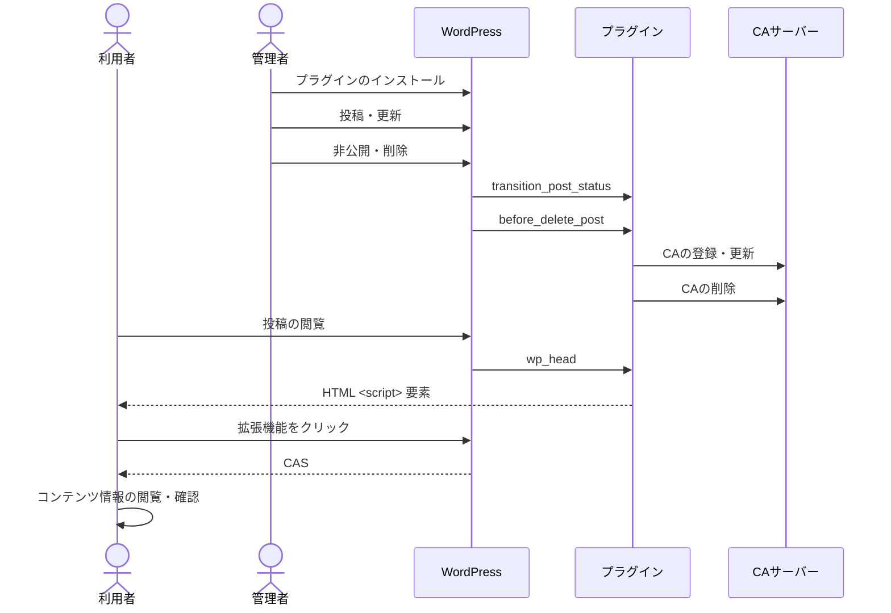

# WordPress プラグイン (CA Manager)

## 目的

WordPress サイトに CA Manager を導入し、記事の公開時に Content Attestation (CA) を自動発行できる状態にする。

電通総研 CA サーバーを利用する場合は、電通総研 CA サーバーの設定マニュアルもあわせて参照してください。

## 前提条件

- WordPress 管理者権限がある
- 動作環境が[動作環境](#environment)の条件を満たしている

## 手順

### 1. プラグインのインストール {#plugin-installation}



1. プラグインのダウンロード:
   「[Releases](https://github.com/originator-profile/originator-profile/releases)」にアクセスし、Assets セクションから WordPress プラグイン（wordpress-ca-manager.zip）を取得
2. プラグインのアップロード:
   WordPress 公式サイト「[プラグイン新規追加画面](https://ja.wordpress.org/support/article/plugins-add-new-screen/)」にある「プラグインをアップロード」の節を参照
3. プラグインの有効化
4. プラグインの設定:
   WordPress 管理者画面の「設定 > CA Manager」にアクセスし、次節「プラグインの設定」の必要項目を入力
5. `/.well-known/sp.json` の配置:
   「[`/.well-known/sp.json` の配置](#well-known-sp-json)」を参照

### 2. プラグインの設定 {#plugin-settings}



プラグインを有効化したら、WordPress 管理画面の「設定 > CA Manager」で以下の項目を設定します。

**[CA issuer's Originator Profile ID]: 自身の Originator Profile ID を指定**

例:

```
dns:media.example.com
```

**[CA サーバーホスト名]: 利用する CA サーバーのホスト名を指定**

例:

```
playground.originator-profile.org
```

**[認証情報]: CA サーバーへのアクセスに必要な情報を指定**

例:

```
cfbff0d1-9375-5685-968c-48ce8b15ae17:GVWoXikZIqzdxzB3CieDHL-FefBT31IfpjdbtAJtBcU
```

**検証対象の種別**

例:

```
TextTargetIntegrity
```

**検証対象要素 CSS セレクター**

例:

```
h1.wp-block-post-title, .wp-block-post-content>*:not(.post-nav-links)
```

**検証対象要素の存在する HTML**

例:

```html
<!DOCTYPE html>
<html>
  <head>
    <meta charset="UTF-8" />
  </head>
  <body>
    <h1 class="wp-block-post-title">%TITLE%</h1>
    <div class="wp-block-post-content">%CONTENT%</div>
  </body>
</html>
```

`%TITLE%` は投稿タイトルに、`%CONTENT%` は `apply_filters()` 適用後の WordPress 投稿内容に置換され、リクエストコンテンツ `target[0].content` プロパティとして CA サーバーに送信されます。

**[CA Presentation Type]: CAS を埋め込み形式かリンク形式か指定**

デフォルトは Embedded です。

- Embedded: CAS を埋め込み形式（Embedded）にして記事を投稿します。
- External: CAS を WordPress の REST API の URL で参照します。静的 JSON ファイルは生成しません。詳しくは「[CA Presentation Type をリンク形式にしたときの配信](#ca-presentation-type-external)」を参照してください。

Embedded を選択したとき出力される HTML の一部の例:

```html
<script type="application/ca-set+json">
  ["eyJ..."]
</script>
```

**ログの出力設定**

デフォルトは無効です。

有効にすると CA Manager プラグインに関するログが出力され、ログファイルをダウンロードできます。
CA の発行をスキップした理由や、保存に失敗した記事もログで確認できます。
生成されるログファイルについては「[ログファイルの生成について](#log-output)」を参照してください。

これらの設定が完了しないと、CA の発行機能は正しく動作しません。
設定が正しく反映されると、それ以降に更新した投稿と新規投稿は自動的に CA サーバーに送信されます。

### 3. 必要に応じて行う設定 {#optional-settings}

CA を発行しない記事がある場合は「[CA 発行対象の除外](#exclusion)」を設定します。
プラグインの導入より前に公開した記事に CA を発行する場合は「[既存記事の CA 一括発行](#bulk-issuance)」を利用します。

## 確認方法 {#how-to-check}

設定が完了したら、新規投稿の作成または既存投稿の更新（再保存）を行ってください。
CA が正しく発行されているかどうかは、次の 2 つの方法で確認できます。

- デベロッパーツールで確認する  
  ブラウザのデベロッパーツールを開き、ページ内に `ca-set+json` タイプの `<script>` タグが埋め込まれているかを確認します。  
  以下のような要素が存在していれば、CA の発行および設定は正常に行われています。

例:

```html
<script type="application/ca-set+json">
  ["eyJ..."]
</script>
```

※ この方法では検証結果までは確認できません。発行されているかどうかの一時確認としてご利用ください。

- [OP Inspector](/inspector) または [Debugger](/debugger) で確認する  
  より詳細に確認したい場合は、 OP Inspector または Debugger を使用します。
  - 対象ページに付与された CA が存在するか
  - CA の検証が成功しているか

  これらを確認できます。  
  それぞれ、使い方は [OP Inspector](/inspector) のドキュメント、[Debugger](/debugger) のドキュメントを参照してください。

**CA が存在しない場合**

- プラグインの設定値が誤っている可能性があります。
- 記事が [CA 発行対象の除外](#exclusion)のルールに一致している可能性があります。
- ログ出力設定を有効にし、ページを保存してログを確認してください。ログの出力設定は[プラグインの設定](#plugin-settings)を参照してください。

**検証に失敗している場合**

- エラーコードに応じて原因が異なります。
- 詳細は[エラーコード一覧](/error-reference/)を参照してください。

## 動作環境 {#environment}

### 動作を検証している環境

- OS: Ubuntu 24.04
- ベースイメージ: `wordpress:6.9.4-php8.2`

CA Manager が動作を検証しているのは、現時点ではこの Docker イメージのみです。

### 互換性のない環境

- Apache 以外の Web サーバー (nginx など): アクセス制御用の `.htaccess` は Apache 向けにしか生成しません。アクセス制御は手動で設定してください。
- Autoptimize（Pro 版を含む）: HTML や画像の minify により署名検証が失敗する可能性があります。「[Autoptimize プラグインとの競合](#autoptimize)」を参照してください。

### PHP のサポート方針

このプラグインは、[アクティブなセキュリティサポートのある PHP](https://endoflife.date/php) を下限としてサポートします。
この下限を下回る PHP は、正式なサポート対象外です。

PHP 7.4 のように下限を下回る環境では、現在のコードのままでは動作しません。
動作させるにはコードの一部を書き換える必要があります。
詳しくは「[もっと古い PHP (7.4 など) でも動かせますか?](#older-php)」を参照してください。

## CA 発行対象の除外 {#exclusion}

「設定 > CA Manager > CA 発行対象の除外」で、CA を自動発行しない URL やパターンを 1 行に 1 件入力し、「除外設定を保存」を押します。
この設定は CA サーバーの設定とは独立して保存できます。
空欄のときは、すべての記事に CA を発行します。

```text
/blog/*
/syndicated/**
/?p=123
https://media.example.com/special/**
```

### ルールの書き方

- `*` は `/` を含まない文字列に、`**` は `/` を含む文字列に一致します。それ以外の文字は正規表現として解釈しません。
- ルール全体で一致を判定します。`/blog/a` は `/blog/abc` に一致しません。`/blog/**` は `/blog/a/b` に一致しますが、`/blog` 自体には一致しません。
- URL とルールのパス末尾の `/` は同一視します。大文字と小文字は区別します。
- `/` で始まるルールはパスとクエリ文字列に対して、絶対 URL のルールは公開 URL 全体に対して判定します。クエリの順序や文字列を変更せずに比較するため、`/?p=123` と `/?p=456` は別の対象です。
- 日本語などの国際化ドメインも指定できます。照合では入力の表記を保持し、Punycode 表記との相互変換は行いません。
- 公開 URL のフラグメントは判定に使用しません。ルールにはフラグメントや認証情報を含められません。
- 空行と各行の前後の空白を除き、重複するルールをまとめます。上限は 200 件、1 件あたり 2048 バイト、合計 65536 バイトです。不正な入力では保存済みの設定を維持し、エラーを表示します。
- いずれかのルールに一致すれば除外します。例外、優先順位、カテゴリや執筆者による指定はありません。

### 判定の確認

保存後、「判定する公開URL（パーマリンク）」に URL を入力して「URLを判定」を押すと、保存済みのルールでの判定を確認できます。
この操作は記事や設定を変更せず、CA サーバーとも通信しません。
入力する URL は、プレビュー画面の一時的な転送先 URL ではなく、記事の公開 URL にしてください。

### 除外が適用されるタイミング

除外の判定は、記事の新規公開時と公開済み記事の更新時に適用します。
分割記事は代表 URL で記事全体を判定し、除外する場合は全ページの自動発行をスキップします。
公開 URL を取得できない場合や設定を評価できない場合も、CA の発行を停止して理由をログに記録します。
どの場合も、記事の公開自体は停止しません。
スキップした理由を確認するには、「ログの出力設定」を有効にしてください。

### 既存 CA の配信停止

**除外設定を保存すると、対象記事の既存 CA も、HTML への埋め込みと外部 URL の両方で配信を停止します。**
分割記事は代表 URL でまとめて判定します。

配信を停止しても、保存済みの CA（データベースの `_profile_post_cas`）は保持します。
CA サーバー上の CA の削除や失効も行いません。

停止状態の保存に成功した記事は、除外を解除しただけでは配信を再開しません。
次回の公開または更新で全ページの CA の再発行と保存が成功してから、配信を再開します。
停止状態の保存に失敗した記事は、除外中は配信を拒否しますが、除外を解除すると旧 CA が再び配信される可能性があります。
保存の失敗を確認するには、「ログの出力設定」を有効にしてください。
設定の保存だけでは、CA を一括で再発行しません。

既存の HTML や JSON がページキャッシュや CDN に残っている場合、WordPress 側で配信を停止しても、それらは消えません。
導入時と除外設定の変更時には、該当するページと CA の URL のキャッシュをパージしてください。
この機能は、すでに取得された CA を撤回するものではありません。

## 既存記事の CA 一括発行 {#bulk-issuance}

「ツール > CA一括発行」または CA Manager 設定画面の「既存記事のCA一括発行」から、公開済みの記事にまとめて CA を発行できます。

### 一括発行の手順

1. 公開済みの投稿と固定ページを、公開日の範囲とカテゴリで絞り込みます。カテゴリを指定すると、そのカテゴリに属する記事だけが対象になります。
2. 「プレビューを取得」で、候補件数と先頭 20 件の判定を確認します。候補件数には発行済みの記事と除外対象の記事も含みます。この操作は CA サーバーと通信しません。
3. 発行範囲を選びます。「未発行のみ」は、空でない CA が保存されている記事をスキップします。「全件」は既存 CA も再発行するため、確認欄を選択してから開始します。どちらにも [CA 発行対象の除外](#exclusion)のルールを適用します。
4. 「一括発行を開始」を押すと、1 記事ずつ処理します。成功、失敗、スキップの件数と、直近 100 件のログを表示します。
5. 「一時停止」を押すか画面を閉じると、次の記事の処理を止めます。通信中の記事は処理が継続する場合があります。同じ画面から状態を取得し、「一括発行を再開」で続行できます。ページを開いただけでは再開しません。
6. 完了後は「失敗した記事を再試行」で、失敗した記事だけを処理できます。「キャンセル」は残りの処理を終了します。すでに発行した CA は元に戻しません。

### 一括発行の条件

開始には、CA サーバーの発行者と認証情報の設定が必要です。
対象の確認（プレビューの取得）は、認証情報がなくても利用できます。
操作には、管理者権限（`manage_options`）と記事の編集権限が必要です。

CA の保存には、`posts` テーブルと `postmeta` テーブルが InnoDB である必要があります。
外側のトランザクションの実行中は、安全のため保存を拒否します。

### 処理の仕組み

一括発行の処理はサイト全体で 1 件だけ実行でき、MySQL/MariaDB の接続単位のロックで同時実行を防ぎます。
進捗と失敗した記事の ID を保存するため、再開時に成功済みの記事を最初から処理し直すことはありません。
新しい処理を開始すると、以前の進捗と表示ログは置き換わります。

開始時点の最大 ID より新しい記事は対象に含めません。
各記事の公開状態、絞り込み条件、除外設定は処理時にも確認するため、実際の処理件数は開始時の候補件数と異なる場合があります。

記事本文、投稿者、公開日と更新日は変更しません。
分割記事は、全ページの応答を取得できた場合だけ CA を保存し、失敗した場合は既存の CA を保持します。
ただし、CA サーバーで発行済みの CA を取り消す処理は行いません。

### タイムアウトと再試行

応答の待機上限は通常 60 秒、1 記事の発行処理は 5 分です。
時間切れになってもサーバー側の処理は継続する場合があるため、「状態を再取得」で確認してください。

通信の中断などで結果が不明な場合、CA Manager は自動で再送せず、その記事を失敗として残します。
再試行する前に、CA サーバー側の結果を確認してください。

## 機能及び参考情報

### 機能

このプラグインの主な機能は以下の通りです。

1. WordPress での投稿・更新時の投稿内容の処理
   - WordPress での投稿または更新をトリガーとします
   - このトリガーにより投稿内容を処理し、CA サーバーの CA 登録・更新エンドポイントに送信します
2. WordPress の投稿ページでの CAS 配信
3. URL のルールによる CA 発行対象の除外と、除外対象の既存 CA の配信停止
4. 公開済みの既存記事への CA の一括発行

### 処理の流れ

WordPress 連携用プラグインでの処理の流れは以下の通りです。
ここでの利用者は Web ブラウザと拡張機能を利用していることを想定しています。



[Hooks](https://developer.wordpress.org/plugins/hooks/) に応じた処理を実行します。

- `transition_post_status` : 投稿・更新のタイミングでトリガーされ、そのコンテンツの内容を変換し、CA サーバーの登録・更新エンドポイントに送信します  
  また、公開から非公開や下書きなど公開以外の状態になったタイミングでトリガーされ、対象コンテンツの CA ID を利用して CA サーバーの削除エンドポイントに送信します
- `before_delete_post` : 投稿が削除されるタイミングでトリガーされ、対象コンテンツの CA ID を利用して CA サーバーの削除エンドポイントに送信します
- `wp_head` : 投稿の閲覧のタイミングでトリガーされ、埋め込まれた `<script>` 要素を介して利用者は CAS を取得します

以上の処理により、投稿したコンテンツは自動的に管理され、利用者はその真正性を確認できます。

### 画像の署名 {#image-signing}

画像ブロック（`core/image`）の画像は、[External Resource Target](/opb/content-integrity-descriptor/external-resource/) として署名します。

- `render_block_core/image` : 画像ブロックの描画時に、添付ファイルの Integrity メタデータ（`_profile_attachment_integrity`）を `` 要素の `integrity` 属性として付与します
- 署名時には、`` 要素の `wp-image-{添付ID}` クラスから `cssSelector`（例: `img.wp-image-123`）を求め、`integrity` とあわせて CA に含めます

```json
{
  "type": "ExternalResourceTargetIntegrity",
  "cssSelector": "img.wp-image-123",
  "integrity": "sha256-... sha256-..."
}
```

検証者は `cssSelector` で対象要素を特定します。
`cssSelector` のない CA（`wp-image-{添付ID}` クラスのない画像や、この対応より前に署名した投稿）では `integrity` 属性で対象要素を特定するため、`integrity` 属性の付与も続けています。

### ファイル構成

#### config.php

`includes` ディレクトリの中に置かれている `config.php` ファイルには、このプラグインの設定値が含まれています。

| 設定値                                    | 説明                                                                                                                                                                                                          |
| ----------------------------------------- | ------------------------------------------------------------------------------------------------------------------------------------------------------------------------------------------------------------- |
| PROFILE_DEFAULT_CA_SERVER_HOSTNAME        | Content Attestation サーバーのホスト名の設定の初期値です。このホスト名のエンドポイントを介して Content Attestation の登録・更新・取得を行います。もし設定画面から設定を変更した場合、この値は参照されません。 |
| PROFILE_DEFAULT_CA_SERVER_REQUEST_TIMEOUT | Content Attestation サーバーへのリクエストのタイムアウト (秒) の初期値です。                                                                                                                                  |
| PROFILE_DEFAULT_CA_TARGET_TYPE            | 検証対象の種別の初期値です。                                                                                                                                                                                  |
| PROFILE_DEFAULT_CA_TARGET_CSS_SELECTOR    | 検証対象要素 CSS セレクターの初期値です。デフォルトでは記事タイトル (`h1.wp-block-post-title`) と記事本文の直下子要素 (`.wp-block-post-content>*:not(.post-nav-links)`) の両方を対象とします。                |
| PROFILE_DEFAULT_CA_TARGET_HTML            | 検証対象要素の存在する HTML の初期値です。`%TITLE%` は投稿タイトルに、`%CONTENT%` は `apply_filters()` 適用後の投稿本文に置換されます。                                                                       |

### CA サーバーの API 認証

CA サーバー API の Basic 認証をサポートしています。
Basic 認証以外の認証方式 (例: OAuth、JWT、API キー) を利用する場合、カスタマイズが必要です。
カスタマイズの方法については、[includes/issue.php](https://github.com/originator-profile/originator-profile/blob/main/packages/wordpress/includes/issue.php) `issue_ca()` の実装をご確認ください。

### OP 対応

#### `/.well-known/sp.json` の配置 {#well-known-sp-json}

配置場所:

ドキュメントルートが /var/www/html の場合、以下のパスに配置します。

```
/var/www/html/.well-known/sp.json
```

Web サーバーの設定によっては `.well-known` ディレクトリへのアクセスが制限されている場合があります。以下のように `.well-known` へのアクセスを許可します。

Apache:

```.htaccess
<Directory "/var/www/html/.well-known">
  AllowOverride None
  Require all granted
</Directory>
```

確認方法:

```
$ curl -sSf https://example.com/.well-known/sp.json
```

OP の含まれる SP が正しく取得できれば設定は完了です。

#### 別の方法: OPの埋め込み

HTML 中に script 要素を用いて OP を埋め込むことが可能です。

具体例:

```html
<script type="application/op-set+json">
  [
    {
      "core": "eyJ...",
      "annotations": ["eyJ..."],
      "media": ["eyJ..."]
    }
  ]
</script>
```

詳細は「[サイトの OP 対応](/tutorial/sp-setup-guide/)」または「[Linking Content Attestation Set and Originator Profile Set to A HTML Document](/opb/link-to-html/)」をご確認ください。

### CA Presentation Type をリンク形式にしたときの配信 {#ca-presentation-type-external}

CA Presentation Type が External のとき、CAS は WordPress の REST API で配信します。
静的 JSON ファイルは生成しません。

外部 URL は `/wp-json/ca-manager/v1/cas/<ポストid>/<ページ番号>` です。
ページ番号は 1 から始まります。
パーマリンク設定が「基本」の場合は `/?rest_route=/ca-manager/v1/cas/<ポストid>/<ページ番号>` の形式になります。

External を選択したとき出力される HTML の一部の例:

```html
<script
  src="https://example.com/wp-json/ca-manager/v1/cas/1/1"
  type="application/ca-set+json"
></script>
```

リクエストごとに記事の公開状態、保存済みの除外ルール、配信停止状態を確認し、配信できる CA だけを返します。
レスポンスには `Cache-Control: no-store` を付与します。
CDN などでも、この URL をキャッシュしないように設定してください。

確認方法:

```
$ curl -sSf https://example.com/wp-json/ca-manager/v1/cas/1/1
```

#### 旧バージョンが生成した静的ファイルの移行

旧バージョンの CA Manager は、External のとき `ABSPATH/cas/<ポストid>_cas.json` に静的ファイルを生成していました。
現在のバージョンは、初回ロード時の移行処理でこのファイルを削除します。
削除に失敗した場合は管理画面に通知し、削除を再試行します。
元のファイルを削除しても、CDN などに残ったコピーは消えないため、別途パージしてください。

### ログファイルの生成について {#log-output}

ログファイルを生成するディレクトリとして下記のように定義されています。

```
const PROFILE_DEFAULT_CA_LOG_DIR = 'ca-manager-log';
```

ドキュメントルートが /var/www/html の場合、以下のパスにログが出力されます。
ログファイルが存在しない場合、新たに生成されます。

```
/var/www/html/wp-content/uploads/ca-manager-log/ca-manager-debug.log
```

また、CA Manager プラグイン有効化時、以下のパスに以下の内容でアクセス制御を行うファイルを自動生成します。

```
/var/www/html/wp-content/uploads/ca-manager-log/.htaccess
/var/www/html/wp-content/uploads/ca-manager-log/index.php
```

Apache:

```.htaccess
<FilesMatch "\.(log|txt)$">
  Require all denied
</FilesMatch>
```

Apache 以外のアクセス制御を行うファイルは自動生成されませんので、適宜アクセス制御を行うようにしてください（推奨）。

無効にするとログ出力が無効になり、ログファイルが削除されます。

### デモ

プラグインインストール済みの試験用環境を用意しています。

- https://op.cms.am/ (最新のメイン試験環境)

デモサイトの編集権限が必要な方は開発チームに相談してください。

### Playground とあわせた使用方法

OP 登録が行えない場合は、Playground を利用して CA の自動発行をテストすることができます。  
詳しくは [Playground のガイド](/playground/#use-wordpress-plugin) を参照してください。

### プラグインの開発

開発用 WordPress サーバーの構築、テストの実行、パッケージングの方法は、[CA Manager の README](https://github.com/originator-profile/originator-profile/tree/main/packages/wordpress#readme) を参照してください。

## 既知の問題

### パーマリンク設定の変更による影響

WordPress のパーマリンク設定を変更すると、各記事の URL が変更されるため、既に発行済みの Content Attestation（CA）は `allowedUrl` の不一致により無効となります。

**影響する操作**:

- 設定 > パーマリンク設定
  - 設定変更
  - カスタム構造の変更

パーマリンク設定を変更した場合、影響を受ける全ての投稿を再度更新（編集・保存）することで、新しい URL に対応した CA が再発行されます。
公開済みの記事が多い場合は、[既存記事の CA 一括発行](#bulk-issuance)で「全件」を選んで再発行できます。

### プラグイン・フィルター・テーマによる HTML の変形

WordPress では、投稿本文に `<!--nextpage-->` を挿入することでページ分割が可能です。ただし、プラグインやテーマ、あるいはフィルターフックの影響により、これが `<p><!--nextpage--></p>` のように不適切なマークアップで出力される場合があります。このような出力は、意図しない改行や空行の原因となります。

**回避策**: 次のように置換処理を行うことで不適切なマークアップを修正できます。

```php
// includes/issue.php

/**
 * 未署名 Content Attestation の一覧の作成
 *
 * @param \WP_Post $post Post object.
 * @param string   $issuer_id CA 発行者 ID
 * @return list<Uca> 未署名 Content Attestation の一覧
 */
function create_uca_list( \WP_Post $post, string $issuer_id ): array {
	// ... 省略 ...

	// 置換処理を追加
	$post->post_content = str_replace('<p><!--nextpage--></p>', '<!--nextpage-->', $post->post_content);

	$postdata = \generate_postdata( $post );

	// ... 省略 ...
}
```

### Autoptimize プラグインとの競合 {#autoptimize}

[Autoptimize](https://ja.wordpress.org/plugins/autoptimize/)（[Pro版](https://autoptimize.com/pro/)を含む）は、HTML や画像の最適化（minify）を行うプラグインです。これにより、以下のような問題が発生する可能性があります。

#### 署名対象 HTML との不整合

Autoptimize による minify 前の HTML が CA Server に送信される場合、実際に表示される HTML と一致せず、署名検証が失敗する可能性があります。

**対応方針**: Autoptimize の minify 処理後の HTML を調整し、それを CA Server に送信

#### Pro 版 CDN による画像 URL の変換

Pro 版では、画像が CDN 経由で変換され、URL が変化する場合があります。これにより署名対象の HTML と実際の表示内容に差異が生じます。

**対応方針**: CDN 変換後の画像 URL を取得し、それを反映した HTML を CA Server に送信

### CA サーバー側でのデータ削除

メタデータ `_profile_post_cas` に CAS が保存されている状態で、 CA サーバー側のデータが手動で削除された場合、記事更新時に UUID を指定した新規登録が試みられます。これはサーバー側でエラーとなる可能性があります。

**回避策**： 一度記事を非公開にすることで、メタデータがクリアされます。その後再度公開することで UUID を指定しない新規登録となり、正常に登録されます。

### 他の投稿に添付済みの画像を再利用すると Integrity が付与されないことがある

WordPress の `get_attached_media()` は、`post_parent`（画像がどの投稿にアップロードされたか）が対象の投稿と一致する添付ファイルだけを返します。

そのため、画像ブロックの「メディアライブラリ」タブから、他の投稿にアップロード済みの画像を選んで挿入すると、その画像は `get_attached_media()` で取得されず、Integrity メタデータ（`_profile_attachment_integrity`）が生成されないことがあります。
この場合、その画像は CA の署名対象（[External Resource Target](#image-signing)）に含まれません。

また、画像のアップロード時に Integrity メタデータを計算できていても、何らかの理由で値が壊れた状態（例: `integrity="sha256-"` のようにハッシュ部分が空）で保存されることがあります。
この状態は `get_attached_media()` で再取得して再検証するまで残り続け、CA の検証エラー（`ERR_CONTENT_ATTESTATION_SET_VERIFY_FAILED`）の原因になることがあります。

**確認方法**: ログ出力を有効にすると、Integrity が欠落している画像や不正な画像の URL が記録されます。

```
Post ID <投稿ID>, page <ページ番号>: image(s) with missing or invalid integrity (possibly not returned by get_attached_media(), or hash could not be computed): <画像URL>, ...
```

**回避策**: 該当する画像をメディアライブラリから直接アップロードし直すと、その投稿に添付され、Integrity メタデータが生成されます。

### もっと古い PHP (7.4 など) でも動かせますか? {#older-php}

現在のコードのままでは動きません。
ただし、次の 3 箇所を書き換えれば動く可能性があります（PHP 7.4 上での動作は確認していません）。

1. コンストラクタプロパティプロモーション (PHP 8.0+): `includes/class-uca.php` のクラスコンストラクタ引数 `public string $issuer`
2. ユニオン型 (PHP 8.0+): `includes/class-uca.php` のメソッドの戻り値の型 `string|false`
3. `mixed` 型 (PHP 8.0+): `includes/issue.php` と `includes/class-uca.php` の一部

なお、PHP 7.4 は 2022 年 11 月にセキュリティ更新が終了しており、本番サイトでの利用はおすすめできません。
