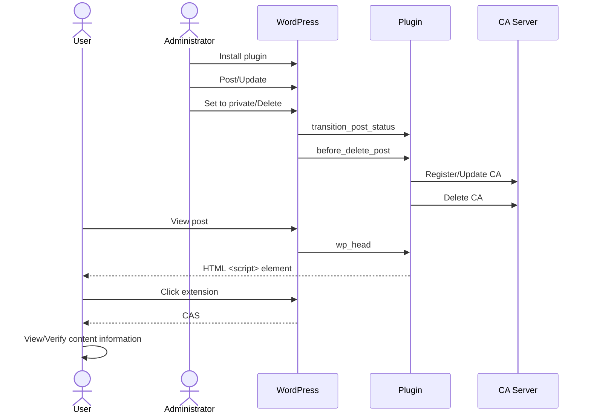

# WordPress Plugin (CA Manager)

## Objective

Integrate CA Manager into your WordPress site to enable the automatic issuance of Content Attestation (CA) whenever an article is published.

If you are using the Dentsu Soken CA server, please also refer to the Dentsu Soken CA server configuration manual.

## Prerequisites

- The operating environment meets the requirements specified in [Operating Environment](#environment).

## Procedure

### 1. Plugin Installation {#plugin-installation}


1. Download the plugin:
   Visit the "[Releases](https://github.com/originator-profile/originator-profile/releases)" page and download the WordPress plugin (`wordpress-ca-manager.zip`) from the Assets section.
2. Upload the plugin:
   Refer to the "Upload Plugin" section on the WordPress "[Add Plugins](https://wordpress.org/support/article/plugins-add-new-screen/)" screen.
3. Activate the plugin.
4. Configure the plugin:
   Go to "Settings > CA Manager" in the WordPress admin dashboard and enter the required information as described in the next section, "Plugin Settings."
5. Placement of `/.well-known/sp.json`:

   Refer to "[Placement of `/.well-known/sp.json`](#well-known-sp-json)."

### 2. Plugin Settings {#plugin-settings}


After activating the plugin, you must configure it by entering the following required fields.
Once the plugin is activated, configure the following items under "Settings > CA Manager" in the WordPress admin dashboard.

**[CA issuer's Originator Profile ID]: Specify your Originator Profile ID**

Example:

```
dns:media.example.com
```

**[CA Server Hostname]: Specify the hostname of the CA server to use**

Example:

```
playground.originator-profile.org
```

**[Authentication Information]: Specify the information required to access the CA server**

Example:

```
cfbff0d1-9375-5685-968c-48ce8b15ae17:GVWoXikZIqzdxzB3CieDHL-FefBT31IfpjdbtAJtBcU
```

**Verification Target Type**

Example:

```
TextTargetIntegrity
```

**CSS Selector for Verification Target Element**

Example:

```
h1.wp-block-post-title, .wp-block-post-content>*:not(.post-nav-links)
```

**HTML Containing the Verification Target Element**

Example:

```html
<!DOCTYPE html>
<html>
  <head>
    <meta charset="UTF-8" />
  </head>
  <body>
    <h1 class="wp-block-post-title">%TITLE%</h1>
    <div class="wp-block-post-content">%CONTENT%</div>
  </body>
</html>
```

`%TITLE%` is replaced by the post title, and `%CONTENT%` is replaced by the WordPress post content after `apply_filters()` has been applied; these are then sent to the CA server as the `target[0].content` property of the request.

**[CA Presentation Type]: Specify whether the CAS is embedded or linked**

The default is Embedded.

- Embedded: Embeds the CAS directly into the HTML.
- External: References CAS via the WordPress REST API URL. No static JSON files are generated. For details, see "[Delivery when CA Presentation Type is set to link format](#ca-presentation-type-external)."

An example of a portion of the HTML output when "Embedded" is selected:

```html
<script type="application/ca-set+json">
  ["eyJ..."]
</script>
```

- External: Generates the CAS as a static file and posts the article using the link format (External). For details on the generated files, please refer to "[File generation for the External CA Presentation Type](#ca-presentation-type-external)."

**Log Output Settings**

The default is disabled.

If enabled, logs related to the CA Manager plugin are generated, and you can download the log files.
The logs allow you to check reasons why CA issuance was skipped, as well as identify any items that failed to be saved.
For details regarding the generated log files, please refer to "[About Log File Generation](#log-output)."

If these settings are not completed, the CA issuance feature will not function correctly.
Once the settings have been properly applied, any posts updated or created thereafter will be automatically sent to the CA server.

### 3. Optional settings {#optional-settings}

For articles where you do not wish to issue a CA, configure the "[Exclusion from CA Issuance](#exclusion)" setting.
To issue CAs for articles published before the plugin was installed, use the "[Bulk CA Issuance for Existing Articles](#bulk-issuance)" feature.

## How to Check {#how-to-check}

Once configuration is complete, create a new post or update (re-save) an existing post.
You can verify whether the CA has been correctly issued using the following two methods:

- Check using Developer Tools  
  Open your browser's developer tools and check if a `<script>` tag with the type `ca-set+json` is embedded in the page.
  If an element like the one below exists, the CA has been issued and configured correctly.

Example:

```html
<script type="application/ca-set+json">
  ["eyJ..."]
</script>
```

**Note:** This method does not show verification results; use it only for a quick check to see if the CA has been issued.

- Check using [OP Inspector](/inspector) or [Debugger](/debugger)
  Use OP Inspector or Debugger for a more detailed check.
  - Does the CA exist on the target page?
  - Was the CA verification successful?

  You can verify these points.
  Please refer to the [OP Inspector](/inspector) documentation and [Debugger](/debugger) documentation for instructions on how to use each tool.

**If the CA does not exist**

- The article may match the rules for [exclusion from CA issuance](#exclusion).
- Enable the log output setting, save the page, and check the logs. For log output settings, please refer to [Plugin Settings](#plugin-settings).

**If verification fails**

- The cause depends on the error code.
- Please refer to the [Error Code List](/error-reference/) for details.

## Operating Environment {#environment}

### Verified Environment

- OS: Ubuntu 24.04
- Base image: `wordpress:6.9.4-php8.2`

At present, this is the only Docker image for which CA Manager has been verified.

### Incompatible Environments

- Web servers other than Apache (e.g., nginx): The `.htaccess` files generated for access control are specific to Apache. Please configure access control manually.
- Autoptimize (including the Pro version): Minification of HTML or images may cause signature verification to fail. Please refer to "[Conflicts with the Autoptimize Plugin](#autoptimize)."

### PHP Support Policy

This plugin supports PHP versions that are currently receiving active security support (see [PHP end-of-life dates](https://endoflife.date/php)).
PHP versions older than this range are not officially supported.

In environments running PHP versions below this threshold—such as PHP 7.4—the plugin will not function in its current state.
To make it work, some parts of the code must be modified.
For more details, please refer to "[Can I use it with older PHP versions (e.g., 7.4)?](#older-php)"

## Excluding URLs from CA Issuance {#exclusion}

Under "Settings > CA Manager > Exclude from CA Issuance," enter the URLs or patterns for which you do not want CAs to be automatically issued—one entry per line—and click "Save Exclusion Settings."
This configuration is stored independently of the CA server settings.
If left blank, CAs will be issued for all posts.

```text
/blog/*
/syndicated/**
/?p=123
https://media.example.com/special/**
```

### Defining Rules

- `*` matches a string that does not contain `/`, while `**` matches a string that may contain `/`. No other characters are interpreted as regular expressions.
- Each rule must match the entire target string. `/blog/a` does not match `/blog/abc`. `/blog/**` matches `/blog/a/b`, but does not match `/blog` itself.
- Trailing slashes (`/`) in both URLs and rule paths are treated as identical. Matching is case-sensitive.
- Rules beginning with `/` are evaluated against the path and query string, while rules defined as absolute URLs are evaluated against the entire public URL. Comparisons are performed without altering the order or content of the query string; therefore, `/?p=123` and `/?p=456` are treated as distinct.
- Internationalized domain names (such as those containing Japanese characters) are supported. The input format is preserved during matching; no conversion to or from Punycode is performed.
- URL fragments are not used for evaluation. Rules cannot include fragments or authentication credentials.
- Duplicate rules are consolidated (ignoring empty lines and leading/trailing whitespace). Limits are set at 200 rules, with a maximum of 2,048 bytes per rule and a total limit of 65,536 bytes. If invalid input is provided, the existing configuration is retained, and an error message is displayed.
- If a URL matches any of the defined rules, it will be excluded. There are no provisions for exceptions, priority levels, or filtering based on categories or authors.

### Verifying Evaluations

After saving your rules, you can test them by entering a URL into the "Public URL (Permalink) to Evaluate" field and clicking "Evaluate URL."
This action does not modify any articles or settings, nor does it communicate with the CA server.
Please ensure that the URL you enter is the article's public URL, rather than a temporary redirect URL from a preview screen.

### When Exclusions Are Applied

Exclusion checks are performed when an article is first published or when an already published article is updated.
For multi-page (paginated) articles, the entire article is evaluated based on its primary (canonical) URL; if an exclusion applies, automatic CA issuance for all pages of that article will be skipped. If a public URL cannot be retrieved or settings cannot be evaluated, the issuance of the CA will be halted, and the reason will be logged.
In any such case, the publication of the article itself will not be interrupted.
To review the reasons for any skipped items, please enable the "Log Output Settings."

### Stopping CA Delivery for Existing Articles

**Saving exclusion settings will stop the delivery of existing CAs for the affected articles—both those embedded in the HTML and those provided via external URLs.**
For articles split into multiple parts, the determination is made collectively based on the primary (representative) URL.

Even when delivery is stopped, the saved CA data (stored as `_profile_post_cas` post metadata in the database) is retained.
The CA is neither deleted nor revoked from the CA server.

For articles where the "stopped" status has been successfully saved, delivery will not resume simply by removing the exclusion.
Delivery will only resume after the CAs for all pages have been successfully re-issued and saved during the next publication or update.
For articles where saving the "stopped" status failed, delivery will be blocked while the exclusion is active; however, if the exclusion is removed, the previous CA might be served again.
To check for any failures in saving these settings, please enable the "Log Output Settings."
Simply saving the settings does not trigger a bulk re-issuance of CAs.

If existing HTML or JSON content remains in page caches or on a CDN, it will not be removed even if delivery is stopped within WordPress.
When initially setting up the plugin or modifying exclusion settings, please purge the cache for the affected pages and CA URLs.
This feature does not revoke CAs that have already been issued.

## Bulk CA Issuance for Existing Articles {#bulk-issuance}

You can issue CAs for previously published articles in bulk via "Tools > Bulk CA Issuance" or the "Bulk CA Issuance for Existing Articles" section within the CA Manager settings screen.

### Bulk Issuance Procedure

1. Filter your published posts and pages by publication date range and category. Specifying a category limits the scope to only those articles belonging to that category.
2. Use "Get Preview" to check the number of candidate articles and view the first 20 items identified. The candidate count includes both articles that have already been issued a CA and those marked for exclusion. This action does not communicate with the CA server.
3. Select the issuance scope. Choosing "Unissued only" skips articles that already have a CA stored. Choosing "All" will re-issue CAs for existing entries; please review the items before proceeding. The rules for [CA issuance exclusion](#exclusion) apply in both cases.
4. Click "Start Bulk Issuance" to process articles one by one. The system will display the number of successful, failed, and skipped items, along with a log of the most recent 100 operations.
5. Clicking "Pause" or closing the screen will halt the processing of subsequent articles. Note that an article currently in the middle of a network request may still complete its process. You can resume by returning to the same screen and selecting "Resume Bulk Issuance." Simply opening the page will not automatically resume the process.
6. Once finished, you can use "Retry Failed Articles" to process only those that previously failed. Selecting "Cancel" will terminate the remaining operations; note that this does not revert CAs that have already been issued.

### Requirements for Bulk Issuance

To begin, you must configure the CA server issuer and authentication credentials.
You may verify the target articles (via "Get Preview") even without authentication credentials.
Performing these actions requires administrator privileges (`manage_options`) as well as permission to edit articles.

For CA data to be saved, the `posts` and `postmeta` tables must use the InnoDB storage engine.
To ensure data integrity, the system will refuse to save data if an external transaction is currently in progress.

### How It Works

Only one bulk issuance process can run on the site at a time; concurrent execution is prevented through locks applied at the MySQL/MariaDB connection level. Progress and the IDs of failed articles are saved, ensuring that articles already successfully processed are not re-processed when a task is resumed.
Starting a new process will overwrite previous progress and display logs.

Articles with an ID greater than the maximum ID present at the time the process begins are excluded from the scope.
Because an article's publication status, filtering criteria, and exclusion settings are re-verified at the time of processing, the actual number of articles processed may differ from the number of candidates identified at the start.

The article body, author, publication date, and update date remain unchanged.
For multi-page (split) articles, a Content Archive (CA) is saved only if responses for all pages are successfully retrieved; if any part fails, the existing CA (if any) is retained.
Note that the system does not perform operations to revoke CAs that have already been issued by the CA server.

### Timeouts and Retries

The maximum wait time for a response is generally 60 seconds, and the processing limit for a single article is 5 minutes.
As server-side processing may continue even after a timeout occurs, please verify the status using the "Refresh Status" function.

If the outcome is uncertain—for instance, due to a communication interruption—the CA Manager will not automatically retry; instead, it will mark the article as having failed.
Before attempting a retry, please verify the actual outcome on the CA server.

## Features and Reference Information

### Features

The main features of this plugin are as follows:

1. Processing post content upon posting or updating in WordPress

   - Triggered by posting or updating content in WordPress
   - Processes the post content based on this trigger and sends it to the CA server's CA registration/update endpoint

2. CAS delivery on WordPress post pages
3. Excluding targets from CA issuance based on URL rules, and halting the distribution of CAs for those excluded items
4. Bulk issuance of CAs for existing, already-published articles

### Processing Flow

The processing flow for the WordPress integration plugin is as follows.
It is assumed here that the user is utilizing a web browser and the extension.



Processing is executed in accordance with [Hooks](https://developer.wordpress.org/plugins/hooks/).

- `transition_post_status`: Triggered when a post is created or updated; it converts the content and sends it to the CA server's registration or update endpoint.<br />
  It is also triggered when a post changes from a published state to a non-published state (such as private or draft), using the content's CA ID to send a request to the CA server's deletion endpoint.
- `before_delete_post`: Triggered when a post is deleted; it uses the content's CA ID to send a request to the CA server's deletion endpoint.
- `wp_head`: Triggered when a post is viewed; it allows the user to retrieve the CAS via an embedded `<script>` element.

Through these processes, published content is automatically managed, enabling users to verify its authenticity.

### Image Signing {#image-signing}

Images within an image block (`core/image`) are signed as an [External Resource Target](/opb/content-integrity-descriptor/external-resource/).

- `render_block_core/image`: When an image block is rendered, the attachment's integrity metadata (`_profile_attachment_integrity`) is applied as an `integrity` attribute to the `` element.
- During the signing process, a `cssSelector` (e.g., `img.wp-image-123`) is derived from the `wp-image-{attachment_ID}` class on the `` element and included in the Content Assertion (CA) alongside the `integrity` value.

```json
{
  "type": "ExternalResourceTargetIntegrity",
  "cssSelector": "img.wp-image-123",
  "integrity": "sha256-... sha256-..."
}
```

The verifier uses the `cssSelector` to identify the target element.
For CAs that lack a `cssSelector` (such as images without a `wp-image-{attachment_ID}` class, or posts signed prior to the implementation of this feature), the `integrity` attribute itself is used to identify the target element; therefore, the `integrity` attribute continues to be applied.

### File Structure

#### config.php

The `config.php` file, located in the `includes` directory, contains the configuration settings for this plugin.

| Setting Name                              | Description                                                                                                                                                                                                                                                     |
| ----------------------------------------- | --------------------------------------------------------------------------------------------------------------------------------------------------------------------------------------------------------------------------------------------------------------- |
| PROFILE_DEFAULT_CA_SERVER_HOSTNAME        | The default value for the Content Attestation server hostname. Registration, updates, and retrieval of Content Attestation data are performed via endpoints on this host. If the setting is modified via the configuration screen, this value is ignored.       |
| PROFILE_DEFAULT_CA_SERVER_REQUEST_TIMEOUT | This is the initial value for the request timeout (in seconds) to the Content Attestation server.                                                                                                                                                               |
| PROFILE_DEFAULT_CA_TARGET_TYPE            | The default value for the type of element to be verified.                                                                                                                                                                                                       |
| PROFILE_DEFAULT_CA_TARGET_CSS_SELECTOR    | The default value for the CSS selector identifying the elements to be verified. By default, both the article title (`h1.wp-block-post-title`) and the direct child elements of the article body (`.wp-block-post-content>*:not(.post-nav-links)`) are targeted. |
| PROFILE_DEFAULT_CA_TARGET_HTML            | The default HTML structure containing the elements to be verified. `%TITLE%` is replaced by the post title, and `%CONTENT%` is replaced by the post body after `apply_filters()` has been applied.                                                              |

### CA Server API Authentication

Basic authentication for the CA server API is supported.
Customization is required if you wish to use authentication methods other than Basic authentication (e.g., OAuth, JWT, API keys).
For details on customization, please refer to the implementation of `issue_ca()` in [includes/issue.php](https://github.com/originator-profile/originator-profile/blob/main/packages/wordpress/includes/issue.php).

### OP Support

#### Placing `/.well-known/sp.json` {#well-known-sp-json}

Placement location:

If the document root is `/var/www/html`, place the file at the following path:

```
/var/www/html/.well-known/sp.json
```

Depending on your web server configuration, access to the `.well-known` directory may be restricted. Configure your server to allow access to `.well-known` as shown below:

Apache:

```.htaccess
<Directory "/var/www/html/.well-known">
  AllowOverride None
  Require all granted
</Directory>
```

Verification:

```
$ curl -sSf https://example.com/.well-known/sp.json
```

Configuration is complete if the SP containing the OP information is successfully retrieved.

#### Alternative Method: Embedding the OP

It is possible to embed the OP directly into the HTML using a `script` element.

Example:

```html
<script type="application/op-set+json">
  [
    {
      "core": "eyJ...",
      "annotations": ["eyJ..."],
      "media": ["eyJ..."]
    }
  ]
</script>
```

For details, please refer to "[Enabling OP Support on Your Site](/tutorial/sp-setup-guide/)" or "[Linking Content Attestation Set and Originator Profile Set to A HTML Document](https://docs.originator-profile.org/opb/link-to-html/)."

### Delivery when CA Presentation Type is set to link format {#ca-presentation-type-external}

When the CA Presentation Type is set to "External," the CAS delivers content via the WordPress REST API.
It does not generate static JSON files.

The external URL is `/wp-json/ca-manager/v1/cas/<post-id>/<page-number>`.
Page numbering starts at 1.
If the permalink setting is set to "Plain," the format will be `/?rest_route=/ca-manager/v1/cas/<post-id>/<page-number>`.

An example of some of the HTML output when "External" is selected:

```html
<script
  src="https://example.com/wp-json/ca-manager/v1/cas/1/1"
  type="application/ca-set+json"
></script>
```

For each request, the system checks the publication status of the article, any saved exclusion rules, and the delivery-halted status, returning only those CAs that are eligible for delivery.
The response includes the `Cache-Control: no-store` header.
Please ensure that this URL is not cached—for instance, by configuring your CDN accordingly.

Verification method:

```
$ curl -sSf https://example.com/wp-json/ca-manager/v1/cas/1/1
```

#### Migration of Static Files Generated by Previous Versions

In previous versions of CA Manager, when the "External" setting was used, static files were generated at the following location: `ABSPATH/cas/<post_id>_cas.json`.
The current version deletes these files during the migration process that occurs upon the initial load.
If the deletion fails, a notification will be displayed in the admin dashboard, and the system will attempt to delete them again.
Please note that deleting the original files will not remove any copies that may remain on a CDN or similar services; you will need to purge those separately.

### Log File Generation {#log-output}

The directory for generating log files is defined as follows:

```
const PROFILE_DEFAULT_CA_LOG_DIR = 'ca-manager-log';
```

If the document root is `/var/www/html`, logs are output to the following path.
If the log file does not exist, it will be created.

```
/var/www/html/wp-content/uploads/ca-manager-log/ca-manager-debug.log
```

Additionally, when the CA Manager plugin is activated, files for access control are automatically generated at the following paths with the specified contents:

```
/var/www/html/wp-content/uploads/ca-manager-log/.htaccess
/var/www/html/wp-content/uploads/ca-manager-log/index.php
```

Apache:

```.htaccess
<FilesMatch "\.(log|txt)$">
  Require all denied
</FilesMatch>
```

Access control files for environments other than Apache are not automatically generated; please implement appropriate access control measures yourself (recommended).

Disabling the feature stops log output and deletes the log file.

### Demo

A test environment with the plugin installed is available:

- https://op.cms.am/ (Latest main test environment)

Please contact the development team if you require editing privileges for the demo site.

### Usage with Playground

If you are unable to perform OP registration, you can use Playground to test the automatic issuance of Content Attestations (CAs).
For details, please refer to the [Playground guide](/playground/#use-wordpress-plugin).

### Plugin Development

Please refer to the [CA Manager README](https://github.com/originator-profile/originator-profile/tree/main/packages/wordpress#readme) for instructions on setting up a WordPress development server, running tests, and packaging the plugin.

## Known Issues

### Impact of Changing Permalink Settings

Changing WordPress permalink settings alters the URLs of individual posts; consequently, previously issued Content Attestations (CAs) become invalid due to an `allowedUrl` mismatch.

**Affected Actions**:

- Settings > Permalinks
  - Changing settings
  - Modifying the custom structure

If you change permalink settings, updating (editing and saving) all affected posts will trigger the re-issuance of CAs corresponding to the new URLs.
If you have a large number of published articles, you can select "All items" under [Bulk issuance of CAs for existing articles](#bulk-issuance) to reissue them.

### HTML Modification by Plugins, Filters, or Themes

In WordPress, you can split a post into multiple pages by inserting `<!--nextpage-->` into the post body. However, due to the influence of plugins, themes, or filter hooks, this may sometimes be output with incorrect markup, such as `<p><!--nextpage--></p>`. Such output can cause unintended line breaks or blank lines.

**Workaround**: You can correct the improper markup by applying a replacement process as follows:

```php
// includes/issue.php

/**
 * Create a list of unsigned Content Attestations
 *
 * @param \WP_Post $post Post object.
 * @param string   $issuer_id CA issuer ID
 * @return list<Uca> List of unsigned Content Attestations
 */
function create_uca_list( \WP_Post $post, string $issuer_id ): array {
	// ... Omitted ...

	// Add replacement logic
	$post->post_content = str_replace('<p><!--nextpage--></p>', '<!--nextpage-->', $post->post_content);

	$postdata = \generate_postdata( $post );

	// ... Omitted ...
}
```

### Conflict with the Autoptimize Plugin {#autoptimize}

[Autoptimize](https://wordpress.org/plugins/autoptimize/) (including the [Pro version](https://autoptimize.com/pro/)) is a plugin that optimizes (minifies) HTML and images. This may cause the following problems:

#### Inconsistency with the Signed HTML

When the HTML before minification by Autoptimize is sent to the CA Server, it may not match the HTML that is actually displayed, potentially causing signature verification to fail.

**Solution**: Adjust the HTML after Autoptimize's minification process and send it to the CA Server.

#### Image URL Transformation via CDN in the Pro Version

In the Pro version, images are transformed via CDN, which may change their URLs. This can result in discrepancies between the signed HTML and the actual displayed content.

**Response Plan**: Obtain the image URL after CDN conversion and send the HTML reflecting it to the CA Server.

### Data Deletion on the CA Server

If the CAS is stored in the metadata `_profile_post_cas` and the data on the CA server is manually deleted, an attempt will be made to register a new post specifying the UUID when updating the article. This may result in an error on the server side.

**Workaround**: Make the article private once to remove the metadata. By making it public again after that, it will be registered as a new entry without a specified UUID, and the registration will complete successfully.

### Reusing an image already attached to another post may result in missing Integrity metadata

WordPress’s `get_attached_media()` function returns only those attachments whose `post_parent` (the post to which the image was originally uploaded) matches the post currently being queried.

Consequently, if you select and insert an image from the "Media Library" tab—an image that was originally uploaded to a different post—it will not be retrieved by `get_attached_media()`. As a result, the Integrity metadata (`_profile_attachment_integrity`) may not be generated for that image. In such cases, the image will not be included in the scope of the CA signature (see [External Resource Target](#image-signing)).

Furthermore, even if the Integrity metadata is successfully calculated at the time of upload, it may occasionally be saved in a corrupted state (for example, where the hash component is empty, such as `integrity="sha256-"`). This state persists until the image is retrieved again via `get_attached_media()` and re-validated; it can lead to a CA verification error (`ERR_CONTENT_ATTESTATION_SET_VERIFY_FAILED`).

**How ​​to verify**: If you enable log output, the system will record the URLs of any images that have missing or invalid Integrity metadata.

```
Post ID <Post ID>, page <Page Number>: image(s) with missing or invalid integrity (possibly not returned by get_attached_media(), or hash could not be computed): <Image URL>, ...
```

**Workaround**: Re-upload the affected image directly via the Media Library; this will attach it to the current post and trigger the generation of the Integrity metadata.

### Can it run on older versions of PHP (e.g., 7.4)? {#older-php}

It will not work with the current codebase.
However, it might be made to work by modifying the following three areas (note that operation on PHP 7.4 has not been verified).

1. Constructor property promotion (PHP 8.0+): The class constructor argument `public string $issuer` in `includes/class-uca.php`
2. Union types (PHP 8.0+): The return type `string|false` for methods in `includes/class-uca.php`
3. `mixed` type (PHP 8.0+): Used in parts of `includes/issue.php` and `includes/class-uca.php`

Please note that security updates for PHP 7.4 ended in November 2022; therefore, its use on production sites is not recommended.
